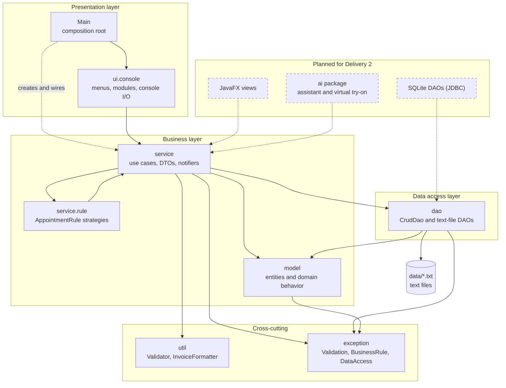

# Maison Glow

A management system for a beauty business in Valledupar, Cesar (Colombia). It centralizes customers, professionals, treatments, products and inventory, appointments, sales and statistics in a single local application, and it is designed to add AI tools (a virtual try-on and a tool-based assistant) behind interfaces.

This is a course project for **Computer Programming III (SS462)**, Systems Engineering, Universidad Popular del Cesar. Instructor: Ing. Esp. Alfredo Bautista.

> **Status: Delivery 1.** The business logic is complete and tested, persistence uses plain text files, and the system is shown through a console (an automatic demo and an interactive menu). The JavaFX interface, the SQLite persistence and the AI adapters belong to Delivery 2. See [Roadmap](#roadmap).

User-facing messages are in Spanish; code, identifiers and Javadoc are in English.

## Table of contents

1. [Features](#features)
2. [Architecture](#architecture)
3. [Tech stack](#tech-stack)
4. [Getting started](#getting-started)
5. [Using the interactive console](#using-the-interactive-console)
6. [Project structure](#project-structure)
7. [Data storage](#data-storage)
8. [Testing](#testing)
9. [Documentation](#documentation)
10. [Development workflow](#development-workflow)
11. [Team](#team)
12. [Roadmap](#roadmap)
13. [License](#license)

## Features

| Area | What the system does |
|---|---|
| Customers | Register, search by name or document, update, delete; track no-shows |
| Treatments | Catalog with price and duration; activate and deactivate |
| Professionals | Working hours, the treatments each one offers, activate and deactivate |
| Products and inventory | Categories, stock control, minimum-stock alerts, stock adjustments |
| Appointments | Booking with schedule-conflict detection, reschedule, confirm, cancel, complete, no-show |
| Appointment rules | Deposit, minimum notice, reminder and no-show penalty, read from business settings |
| Sales | Mixed carts of products and treatments, all-or-nothing stock deduction, simulated invoice email |
| Statistics | Per-customer history, best-selling products and treatments, frequent customers |
| Business intelligence | Low-rotation products, administrator notice, promotion suggestions |
| Settings | Business parameters changed without touching the code |

## Architecture

Maison Glow follows a layered architecture. Dependencies point downward only: the presentation layer calls services, services use DAO interfaces, and DAOs know nothing about the layers above them. Only `Main` creates concrete objects (composition root), so every service receives its dependencies through its constructor.



| Layer | Package | Responsibility |
|---|---|---|
| Presentation | `com.maisonglow.ui.console`, `Main` | Read input, show results and errors. No business rules |
| Business | `service`, `service.rule`, `model` | Use cases, validation, business rules; entities that own their behavior (`Product.deductStock`, `Appointment.overlapsWith`, `Sale.addLine`) |
| Data access | `dao` | `CrudDao<T>` contract and its text-file implementations over a generic `TextFileDao<T>` |
| Cross-cutting | `util`, `exception` | Input validation, invoice text, a three-exception hierarchy |

Design decisions and their alternatives are recorded as Architecture Decision Records in [`docs/adr/`](docs/adr/README.md). Key points:

- **Persistence behind an interface.** Services depend on `CrudDao<T>`, so replacing text files with SQLite does not change business code ([ADR-0012](docs/adr/0012-persistencia-en-archivos-de-texto.md)).
- **Open for extension.** Appointment rules are strategies injected into `AppointmentService`; new rules and new sellable item types are added as new classes ([ADR-0007](docs/adr/0007-reglas-de-cita-como-estrategias.md)).
- **AI never blocks the business.** The AI features sit behind interfaces with a simulated implementation, and their tools call services, never DAOs ([ADR-0005](docs/adr/0005-ia-desacoplada-por-interfaces.md), [ADR-0006](docs/adr/0006-herramientas-del-asistente-tipo-mcp.md)).

Class and package diagrams generated from the code: [`docs/fase2/diagramas.md`](docs/fase2/diagramas.md).

## Tech stack

| Concern | Technology |
|---|---|
| Language | Java 21 |
| Build | Maven 3.9+ |
| Persistence (Delivery 1) | Plain text files with `\|` as field separator |
| Persistence (Delivery 2) | SQLite through JDBC, DAO pattern (schema already designed in [`sql/schema.sql`](sql/schema.sql)) |
| UI (Delivery 2) | JavaFX with FXML and CSS |
| Tests | JUnit 5, AssertJ, Mockito |
| Coverage | JaCoCo, with a 70 % line-coverage gate on the `service` package |

## Getting started

### Prerequisites

- JDK 21 or newer
- Maven 3.9 or newer
- Git

Verify your setup:

```bash
java -version
mvn -version
```

### Clone and build

```bash
git clone https://github.com/samueldrangel/maison-glow.git
cd maison-glow
mvn clean verify
```

`mvn clean verify` compiles the code, runs every test and checks the coverage gate.

### Run

```bash
# Ask which mode to run
mvn -q exec:java

# Automatic demo: runs the complete business scenario and prints it
mvn -q exec:java -Dexec.args=demo

# Interactive console: menus to register, list, update and query data
mvn -q exec:java -Dexec.args=menu
```

| Mode | Data | Purpose |
|---|---|---|
| `demo` | A clean copy in a temporary folder on every run | Show the whole scenario in one go; can be repeated without limit |
| `menu` | `data/session/`, kept between runs and ignored by Git | Explore the system by hand. Delete the folder to start over |

The demo walks through four steps: registering customers, treatments, professionals and products; booking with business rules and conflict rejection; a mixed sale with stock deduction and a simulated invoice; inventory, statistics, the low-rotation notice and promotion suggestions.

On Windows, if accents look garbled, switch the terminal to UTF-8 before running (`chcp 65001`).

## Using the interactive console

The main menu opens one module per business area. Type the number of an option and press Enter; `0` goes back.

```text
=== Maison Glow - Menú principal ===
  1. Clientes
  2. Tratamientos
  3. Profesionales
  4. Productos e inventario
  5. Citas
  6. Ventas
  7. Estadísticas y promociones
  8. Configuración del negocio
  0. Salir
```

Conventions:

- Dates are typed as `yyyy-MM-dd`, times as `hh:mm`, date and time as `yyyy-MM-dd hh:mm`.
- Prices are typed without thousands separators (`28000`).
- Records are picked by the id shown in brackets, for example `[3] Corte de cabello`.
- A rejected operation (invalid data, schedule conflict, insufficient stock) shows its reason and returns to the menu.

A minimal first session, in order:

1. Treatments: register a treatment.
2. Customers: register a customer.
3. Professionals: register a professional and assign the treatment.
4. Products: register a product with an initial stock.
5. Appointments: book the treatment. With a deposit of `0` the system reports the minimum required.
6. Sales: build a cart, confirm it and read the simulated invoice.
7. Statistics: review the customer and the stock alerts.

## Project structure

```text
maison-glow/
├── data/                       Preloaded settings and categories; runtime data is ignored by Git
├── docs/
│   ├── adr/                    Architecture Decision Records
│   ├── fase1/                  Problem identification and specification
│   ├── fase2/                  Class design, diagrams and UI mockups
│   ├── fase4/                  ER model and data dictionary
│   ├── roadmap.md              Delivery 1 plan by team member
│   └── version-control.md      Commits and pull requests per member
├── sql/
│   ├── schema.sql              Relational schema (22 tables, 4 views, 3 triggers)
│   └── seed.sql                Initial data
├── src/
│   ├── main/java/com/maisonglow/
│   │   ├── Main.java           Entry point and composition root
│   │   ├── dao/                CrudDao, TextFileDao and the text-file DAOs
│   │   ├── exception/          ValidationException, BusinessRuleException, DataAccessException
│   │   ├── model/              Entities: Person, Customer, Professional, Product, Treatment,
│   │   │                       Appointment, Sale and related types
│   │   ├── service/            Use cases, DTOs and notifiers
│   │   │   └── rule/           AppointmentRule and its implementations
│   │   ├── ui/console/         Interactive console: menus and modules
│   │   └── util/               Validator, InvoiceFormatter
│   └── test/java/              Unit and integration tests
├── PLANIFICACION.md            Project plan
├── TEAM.md                     Roles, class distribution and reassignments
└── pom.xml
```

## Data storage

In Delivery 1 every entity is stored in a text file, one record per line, with `|` as the separator (and escaping for values that contain it). Each file mirrors a table of [`sql/schema.sql`](sql/schema.sql), so moving to SQLite changes only the DAO implementations.

| File | Table |
|---|---|
| `customers.txt` | `customer` |
| `professionals.txt`, `professional_treatments.txt` | `professional`, `professional_treatment` |
| `treatments.txt` | `treatment` |
| `categories.txt` | `product_category` |
| `products.txt` | `product` |
| `appointments.txt` | `appointment` |
| `sales.txt`, `sale_lines.txt` | `sale`, `sale_line` |
| `settings.txt` | `app_setting` |

A sale validates the stock of every line before touching any file, so an invalid sale changes nothing.

## Testing

```bash
mvn clean verify                    # build, run all tests, enforce the coverage gate
mvn test                            # run the tests only
mvn test -Dtest=SaleServiceTest     # run one test class
```

The suite contains unit tests per layer, an end-to-end integration test over real text files in temporary folders, and scripted sessions of the interactive console. Coverage of the `service` package must stay at or above 70 %, and the build fails otherwise.

## Documentation

Project documents are written in Spanish, as required by the course.

| Document | Content |
|---|---|
| [Phase 1](docs/fase1/documento-fase1.md) | Problem statement, state of the art, objectives, functional and non-functional requirements |
| [Class design](docs/fase2/diseno-clases.md) | Packages, classes, relationships, GRASP and SOLID with the real classes |
| [Diagrams](docs/fase2/diagramas.md) | Package and class diagrams generated from the code |
| [UI mockups](docs/fase2/mockups/README.md) | Screens for the JavaFX interface |
| [ER model](docs/fase4/modelo-entidad-relacion.md) and [data dictionary](docs/fase4/diccionario-de-datos.md) | Database design |
| [ADRs](docs/adr/README.md) | Architecture decisions and alternatives |
| [Roadmap](docs/roadmap.md) | Delivery 1 tasks, owners and dependencies |
| [Version control](docs/version-control.md) | Commits and pull requests per member |
| [Project plan](PLANIFICACION.md) | Scope, schedule and risks |

## Development workflow

- Branches: `main` (stable, protected), `develop` (integration) and one short-lived branch per task: `feature/<name>`, `docs/<name>`, `refactor/<name>`, `chore/<name>`.
- Every change enters through a pull request to `develop`, with a normal merge (no squash) so each commit stays visible. Nobody pushes directly to `main` or `develop`, and force pushes are not allowed on shared branches.
- Commits follow [Conventional Commits](https://www.conventionalcommits.org/): `feat`, `fix`, `test`, `docs`, `refactor`, `chore`, with a scope, for example `feat(customer): add duplicate document check`.
- A task is done when it has Javadoc, input validation with the project exceptions, tests, and a green `mvn clean verify`.
- Design checklist for each pull request: SRP, OCP, LSP, ISP, DIP, the GRASP patterns in use, and clean-code rules (intention-revealing names, no magic numbers, no duplicated code).

Details: [ADR-0004](docs/adr/0004-estrategia-git.md) and the [roadmap](docs/roadmap.md#5-flujo-de-git-de-cada-integrante).

## Team

| Member | Role |
|---|---|
| Samuel David Rangel Martínez | Technical lead: core, appointments, sales, AI, documentation |
| Nicoll Gómez | Developer: customers, professionals, treatments, statistics, integration and demo |
| Isabella Celedón | Developer: products, settings, appointment rules, invoice |

See [`TEAM.md`](TEAM.md) for the class distribution and task reassignments.

## Roadmap

| Delivery | Scope | Status |
|---|---|---|
| 1 | Business logic with text-file persistence, database design, UI mockups, console demo and interactive console | In progress |
| 2 | SQLite persistence (JDBC DAOs), JavaFX interface, users and roles, promotions, payments, real invoice email | Planned |
| 2 (AI) | Assistant with whitelisted tools and virtual try-on: backend first, then real API adapters and screens | Planned |

## License

Released under the [MIT License](LICENSE).
