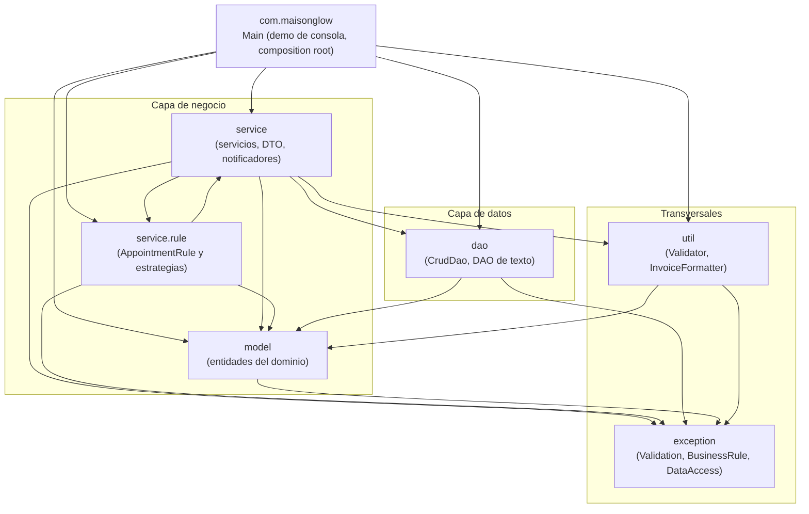
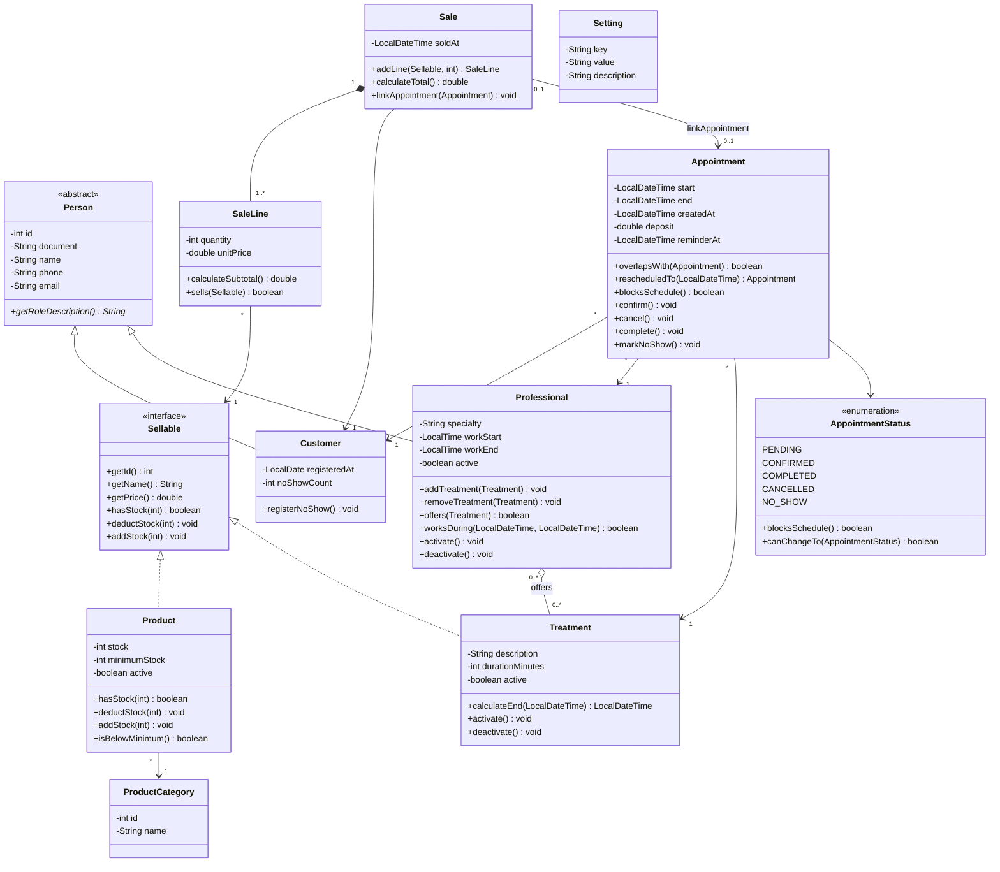
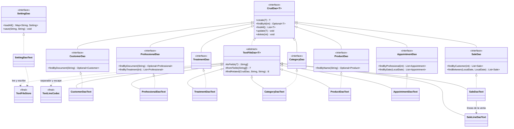
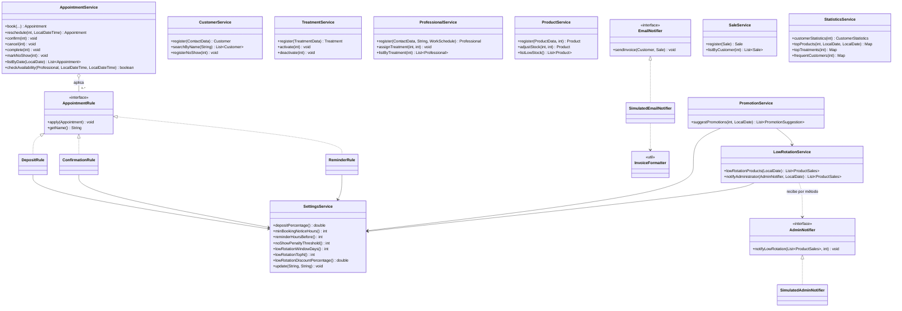

# Diagramas finales · Maison Glow (Entrega 1)

> Diagramas de paquetes y de clases **generados a partir del código real** en `src/main/java/com/maisonglow` (tarea I-06).
> Los diagramas de diseño previos, con nombres en español, están en [`diseno-clases.md`](diseno-clases.md); aquí se usan los nombres del código (inglés).
> Los diagramas son Mermaid y se ven directamente en GitHub.

**Contenido**
1. [Diagrama de paquetes](#1-diagrama-de-paquetes)
2. [Modelo de dominio](#2-modelo-de-dominio)
3. [Acceso a datos (DAO)](#3-acceso-a-datos-dao)
4. [Servicios, reglas y notificadores](#4-servicios-reglas-y-notificadores)
5. [Diferencias frente al diseño inicial](#5-diferencias-frente-al-diseño-inicial)

---

## 1. Diagrama de paquetes

Las flechas son dependencias `import` verificadas en el código. Ningún paquete de capa inferior depende de uno superior: `model` solo conoce a `exception`, y `dao` no conoce a `service`.

| Paquete | Contenido | Depende de |
|---|---|---|
| `model` | `Person`, `Customer`, `Professional`, `Sellable`, `Product`, `ProductCategory`, `Treatment`, `Appointment`, `AppointmentStatus`, `Sale`, `SaleLine`, `Setting` | `exception` |
| `dao` | `CrudDao<T>`, interfaces `XxxDao`, `TextFileDao<T>`, `TextFileStore`, `TextLineCodec` y las implementaciones `XxxDaoText` | `model`, `exception` |
| `service` | Un `XxxService` por módulo, DTO (`ContactData`, `ProductData`, `TreatmentData`, `WorkSchedule`, `CustomerStatistics`, `ProductSales`, `PromotionSuggestion`), `EmailNotifier`, `AdminNotifier` y sus versiones simuladas | `dao`, `model`, `service.rule`, `util`, `exception` |
| `service.rule` | `AppointmentRule`, `DepositRule`, `ConfirmationRule`, `ReminderRule` | `model`, `service` (`SettingsService`), `exception` |
| `util` | `Validator`, `InvoiceFormatter` | `model`, `exception` |
| `exception` | `ValidationException`, `BusinessRuleException`, `DataAccessException` | — |

> **Ciclo `service` ⇄ `service.rule`.** `AppointmentService` recibe la lista de `AppointmentRule` y las reglas leen `SettingsService`, que vive en `service`. Es un ciclo entre dos paquetes de la misma capa, sin ciclo entre clases: `SettingsService` no conoce las reglas. Mover `SettingsService` a un paquete propio lo eliminaría y puede hacerse en la Entrega 2.
>
> **Paquetes `ui` y `ai`.** No existen todavía: la interfaz JavaFX y la IA son de la Entrega 2 (o de S-12 y S-13 si entran antes).

---

## 2. Modelo de dominio

| Elemento | Dónde se ve en el código |
|---|---|
| Herencia | `Customer` y `Professional` extienden `Person` (método abstracto `getRoleDescription()`) |
| Polimorfismo por interfaz | `Sale.addLine(Sellable, int)` acepta `Product` o `Treatment`; el stock se descuenta con `Sellable.deductStock`, un método por defecto que `Product` sobrescribe |
| Composición | `Sale` crea y contiene sus `SaleLine` (`addLine`); una línea no existe sin su venta |
| Agregación N:M | `Professional` guarda sus `Treatment` (`professional_treatments.txt`) |
| Máquina de estados | `AppointmentStatus.canChangeTo` valida cada transición; las inválidas lanzan `BusinessRuleException` |
| Reconstrucción desde disco | `Appointment.restore`, `Sale.restore` y `SaleLine.restore` saltan las reglas de creación |

---

## 3. Acceso a datos (DAO)

Todas las interfaces extienden `CrudDao<T>`, salvo `SettingDao`, cuya clave es texto. Las implementaciones de texto heredan de `TextFileDao<T>` y solo definen `toFields` y `fromFields` ([ADR-0012](../adr/0012-persistencia-en-archivos-de-texto.md)).

| Archivo (`data/`) | DAO | Tabla de `schema.sql` |
|---|---|---|
| `customers.txt` | `CustomerDaoText` | `customer` |
| `professionals.txt`, `professional_treatments.txt` | `ProfessionalDaoText` | `professional`, `professional_treatment` |
| `treatments.txt` | `TreatmentDaoText` | `treatment` |
| `categories.txt` | `CategoryDaoText` | `product_category` |
| `products.txt` | `ProductDaoText` | `product` |
| `appointments.txt` | `AppointmentDaoText` | `appointment` |
| `sales.txt`, `sale_lines.txt` | `SaleDaoText`, `SaleLineDaoText` | `sale`, `sale_line` |
| `settings.txt` | `SettingDaoText` | `app_setting` |

---

## 4. Servicios, reglas y notificadores

Cada servicio recibe sus dependencias **por constructor** y solo `Main` arma las piezas (DIP). Las reglas de cita se agregan como clases nuevas sin tocar `AppointmentService` (OCP, [ADR-0007](../adr/0007-reglas-de-cita-como-estrategias.md)).

Dependencias de datos de cada servicio (constructor):

| Servicio | Recibe |
|---|---|
| `CustomerService` | `CustomerDao` |
| `TreatmentService` | `TreatmentDao` |
| `ProfessionalService` | `ProfessionalDao`, `TreatmentDao` |
| `ProductService` | `ProductDao`, `CategoryDao` |
| `AppointmentService` | `AppointmentDao`, `CrudDao<Customer>`, `List<AppointmentRule>` |
| `SaleService` | `SaleDao`, `ProductDao` |
| `StatisticsService` | `SaleDao`, `AppointmentDao` |
| `LowRotationService` | `SaleDao`, `CrudDao<Product>`, `SettingsService` |
| `PromotionService` | `LowRotationService`, `SaleDao`, `SettingsService` |
| `SettingsService` | `SettingDao` |
| `DepositRule`, `ConfirmationRule`, `ReminderRule` | `SettingsService` |

---

## 5. Diferencias frente al diseño inicial

Cambios entre [`diseno-clases.md`](diseno-clases.md) y el código final:

| Diseño inicial | Código final | Motivo |
|---|---|---|
| `Venta.agregarDetalle`, `DetalleVenta` | `Sale.addLine`, `SaleLine` | Nomenclatura en inglés; mismo comportamiento (Creator) |
| `Vendible` solo con `getId`, `getNombre`, `getPrecio` | `Sellable` suma `hasStock`, `deductStock` y `addStock` por defecto | Descontar stock sin `instanceof` (polimorfismo) |
| `DetalleVenta.esProducto()` con `instanceof` | `SaleLine.sells(Sellable)` | Se eliminó la comprobación por tipo |
| `Cita.getFechaHoraFin()` calculado | `Appointment` guarda `end` y `createdAt` | Se persiste la fila completa de `appointment` |
| `Cita.seCruzaCon(Cita)` | `overlapsWith(Appointment)` y `overlapsWith(LocalDateTime, LocalDateTime)` | Permite consultar disponibilidad sin crear una cita |
| `Cita.confirmar()` valida el estado | `AppointmentStatus.canChangeTo` + `Appointment.rescheduledTo` | La máquina de estados vive en el enum |
| `EstadisticaServicio` con baja rotación | `StatisticsService`, `LowRotationService` y `PromotionService` | Una responsabilidad por clase (SRP) |
| `NotificadorCorreo` en `servicio` | `EmailNotifier` y `AdminNotifier` en `service` | Igual ubicación, nombres en inglés |
| `ConfiguracionServicio` | `SettingsService` + `Setting` + `SettingDao` | Nomenclatura en inglés |
| `TextFileDao` base | `TextFileDao<T>` + `TextFileStore` + `TextLineCodec` | Se separó la lectura y escritura del formato de línea |
| `ConexionBD` en `util` | No existe | La conexión SQLite es de la Entrega 2 |
| Paquetes `vista`, `vista.controlador`, `ia` | No existen todavía | Entrega 2 (la IA backend es opcional: S-12, S-13) |
